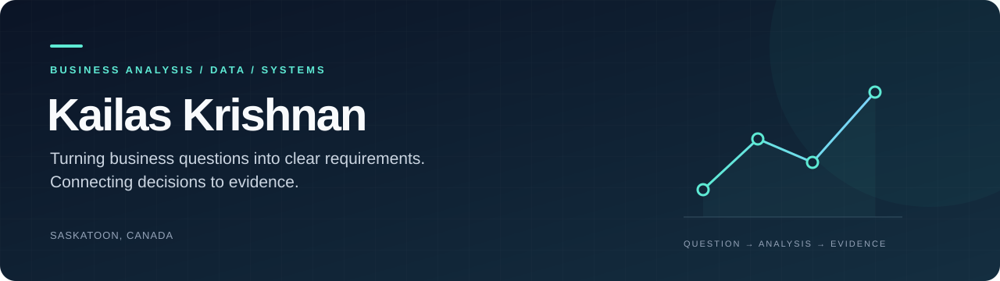

  

  
  &nbsp;
  

  <a href="#about">About</a> &nbsp; / &nbsp;
  <a href="#featured-work">Featured work</a> &nbsp; / &nbsp;
  <a href="#data-projects">Data projects</a> &nbsp; / &nbsp;
  <a href="#toolkit">Toolkit</a>

## About

I'm a **Business Analyst based in Saskatoon, Canada**, interested in how business processes, data and software fit together.

I work with requirements, user stories, process and data modelling, and UAT. My hands-on projects in SQL, cloud infrastructure and application delivery help me understand the systems behind the requirements.

> “The important and difficult job is never to find the right answers—it is to find the right questions!”
>
> **— Peter Drucker** · [Source](https://www.stern.nyu.edu/sites/default/files/assets/documents/con_044994.pdf)

## Featured work

Two independent case studies showing how I move from an unclear problem to a reviewable decision.

<table>
<tr>
<td width="50%" valign="top">

#### 01 &nbsp; / &nbsp; BUSINESS &amp; SYSTEMS ANALYSIS

### ShopStack
**Making the cart journey clear and testable**

Investigated a missing cart-review journey and connected business rules, acceptance criteria and process models to a working cart-viewing slice.

**Explore:** discovery · requirements · wireframes · traceability · acceptance evidence

**Evidence:** 9 planned test families and 6 supplemental checks passed locally and in CI. Another 28 planned families remain not run; independent customer UAT and business sign-off are outstanding.

**[Read the case study ↗](https://kkrishnan937.github.io/shopstack.html)**

[BA artifacts](https://github.com/kkrishnan937/shopstack-ba-portfolio) &nbsp; · &nbsp; [Application source](https://github.com/kkrishnan937/shopstack)

</td>
<td width="50%" valign="top">

#### 02 &nbsp; / &nbsp; AI USE-CASE &amp; DATA READINESS

### Municipal Enquiries
**Testing whether AI supports a sound decision**

Examined enquiry handling, compared improvement options and assessed a local model against keyword rules using 38 synthetic examples.

**Explore:** process maps · options · data readiness · evaluation · recommendation

**Decision:** the model improved clear-case classification but missed too many cases needing review. The recommendation was against operational rollout of either tested method.

**[Read the case study ↗](https://kkrishnan937.github.io/municipal.html)**

[Assessment and evidence](https://github.com/kkrishnan937/municipal-enquiry-ai-assessment)

</td>
</tr>
</table>

These are independent learning projects with simulated stakeholders, not client engagements. AI assisted with role-play, research, drafting, code and testing; the municipal data is synthetic. Project pages distinguish my decisions, executed checks and evidence limitations. No production release or measured business benefits are claimed.

## How I approach the work

| Understand the problem | Make it reviewable | Check the evidence |
| :--- | :--- | :--- |
| Explore the current process, needs and gaps | Define rules, stories and acceptance criteria | Connect requirements to checks and results |
| Clarify stakeholders and decision rights | Use process maps, data models and wireframes | Record limitations and unresolved decisions |

## Data projects

| Project | Focus | Explore |
| :--- | :--- | :--- |
| **Toronto Apartment Evaluation** | Group analysis, modelling and a shared Tableau dashboard | [View project ↗](https://github.com/kkrishnan937/Toronto-apartment-data-analysis) |
| **Data Analyst Job Market** | Five PostgreSQL queries exploring advertised salaries and skill demand | [View SQL ↗](https://github.com/kkrishnan937/SQL_PROJECT_DATA_ANALYSIS) |
| **Australian Car Listings** | MySQL exploration of listing prices, fuel types and an experimental value score | [View analysis ↗](https://github.com/kkrishnan937/australian-car-market-sql-analysis) |

Toronto is a shared group project; the dashboard is hosted on a teammate's account. The job-market learning project still needs dataset attribution and saved results. Car-listing prices are asking prices; the value score is exploratory.

## Toolkit

**Analysis &amp; collaboration**

  
  
  
  
  
  
  

**Technical learning**

  
  
  
  
  

---

  <b>Business context &nbsp; → &nbsp; Clear requirements &nbsp; → &nbsp; Evidence-based decisions</b>
    
  <a href="https://kkrishnan937.github.io/">Explore my portfolio</a>
  &nbsp; · &nbsp;
  <a href="https://www.linkedin.com/in/kailas-krishnan/">Connect on LinkedIn</a>

