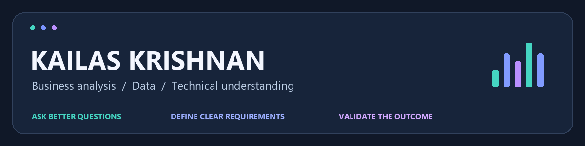

  

  
  
  

## 👋 Hi, I'm Kailas

I'm a Business Systems Analyst interested in how business processes, data, and software fit together. I work with requirements, user stories, process and data modelling, and UAT, supported by hands-on learning in SQL, cloud infrastructure, and application delivery.

This portfolio brings together my analytical projects and technical learning. Each project explains its scope, limitations, and whether the work was individual or collaborative.

### 🧭 What I bring

| 🟦 Business analysis | 🟩 Data and validation | 🟪 Technical understanding |
|---|---|---|
| Requirements and user stories | SQL exploration and data checks | APIs and application behaviour |
| Process and data modelling | KPI definitions and reporting | AWS, containers, and Kubernetes |
| Acceptance criteria and UAT | Interpreting evidence and limitations | Understanding delivery tradeoffs |

## 🚀 Explore my work

<table>
<tr>
<td width="50%" valign="top">

### 🛒 ShopStack
**Application delivery · AWS · Technical analysis**

A three-tier e-commerce learning project using React, Node.js, PostgreSQL, Terraform, Helm, and AWS EKS. Includes architecture explanations and deployment screenshots.

🟣 **Next extension:** a BA case study on checkout reliability, requirements, and UAT. This extension is planned.

</td>
<td width="50%" valign="top">

### 🏙️ Toronto Apartment Evaluation
**Collaborative project · Data analysis · Tableau**

A group project exploring Toronto apartment-building evaluations through analysis, modelling, and a shared dashboard.

🟢 **Contribution:** shared effort across the project. The Tableau dashboard is hosted on a teammate's account; group attribution is documented.

</td>
</tr>
<tr>
<td width="50%" valign="top">

### 📊 Data Analyst Job Market
**PostgreSQL · Joins · CTEs · Aggregation**

Five SQL queries exploring advertised salaries and skill demand in remote Data Analyst postings.

🔵 **Scope:** query construction and analytical reasoning. Dataset provenance and saved outputs still need to be added for reproducibility.

</td>
<td width="50%" valign="top">

### 🚗 Australian Car Listings
**MySQL · Pricing · Metric interpretation**

Exploratory SQL analysis of vehicle listings, brand-level prices, fuel types, and an experimental shortlist.

🟠 **Analytical focus:** distinguishing asking prices from value retention, and documenting the limits of a mixed-unit score.

</td>
</tr>
</table>

## 🧰 Tools I work with and study

**Analysis and collaboration**

  
  
  
  
  
  
  

**Technical learning**

  
  
  
  
  

## 🌱 Building next

**ShopStack: Checkout Reliability and Requirements Analysis**

The planned case study will connect potential defects to business consequences, define business rules and acceptance criteria, and trace requirements through testing. Reproduced findings, completed work, and measured results will be labelled separately from proposals.

---

  <b>Clear requirements. Thoughtful questions. Evidence that holds up.</b> 
  <a href="https://www.linkedin.com/in/kailas-krishnan/">Connect with me on LinkedIn ↗</a>

